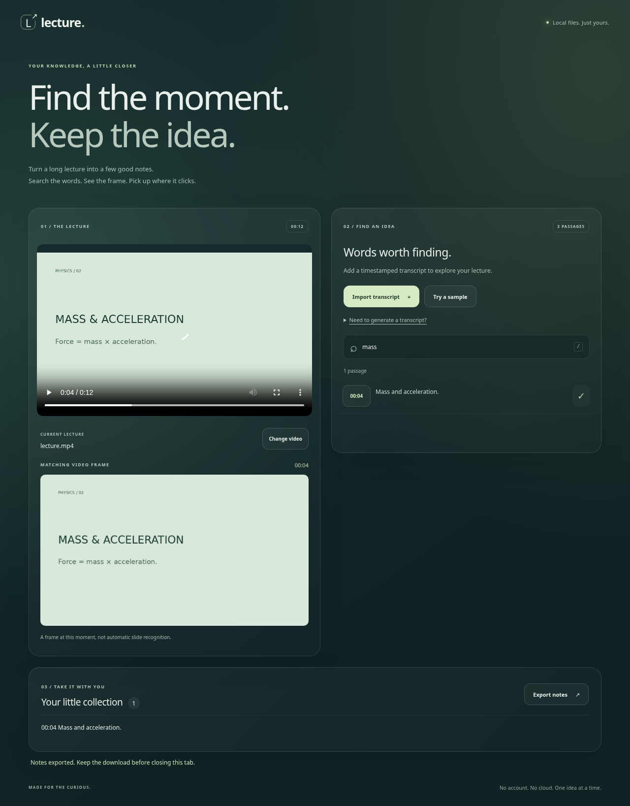

# Lecture — slide finder

A local-first lecture player with transcript search, a video-frame preview and timestamped study notes. A minimal, frosted-glass interface for desktop and Android browsers, plus a bundled Android test APK. No account, paid AI API or media-upload server.



## What works in v0.1

- Open a video from your device; H.264/AAC MP4 is recommended. Playback depends on the browser's codecs.
- Import timestamped **SRT, WebVTT or JSON**, or generate JSON using the included **local Python speech-recognition tool**.
- Search transcript words (case-insensitive, all query words must occur in a passage). This is keyword search, not semantic AI search.
- Tap a timestamp to seek the video and capture its frame nearby. It shows the slide **if the slide is visible at that moment**; there is no automatic slide recognition, OCR, deck extraction or slide-change detection yet.
- Save passages and export a Markdown file with timestamps. Notes stay in the tab; **export before closing**. Replacing a lecture/transcript warns before clearing selected notes.
- Responsive touch-friendly layout, labelled controls, keyboard focus, reduced-motion support and a cacheable PWA shell.

## Run locally

Install Node.js **22.12+** (Node 24 recommended) and **pnpm 11.9.0**. Then:

```sh
git clone https://github.com/himangshurajg-bit/lecture-slide-finder.git
cd lecture-slide-finder
pnpm install --frozen-lockfile
pnpm dev
```

Open the local address Vite prints. For the production build:

```sh
pnpm build
pnpm preview
```

There is no backend. `dist/` is the static site. A relative base supports hosting under a subdirectory. No public deployment is configured by this project.

### Generate a real transcript on a computer

Install Python 3.10+ and [uv](https://docs.astral.sh/uv/getting-started/installation/), then run:

```sh
uv run tools/transcribe.py /path/to/lecture.mp4 --model tiny --language en
# Produces /path/to/lecture.transcript.json. Import that file in the app.
```

The script uses `faster-whisper` on CPU with int8 computation. `uv` installs its isolated dependencies. First use downloads the selected speech model; the audio/video is processed locally, not sent to an AI API. Cached models can run without another model download. Allow local disk space, memory and processing time; larger models are slower and need more resources. `tiny` trades accuracy for a smaller download. Omit `--language` to detect, or supply a supported ISO language code. Test quality in your language.

```sh
uv run tools/transcribe.py lecture.mp4 --model base --language hi --output lecture-hi.json
```

The tool refuses to overwrite an existing transcript unless `--force` is supplied, and never allows output to replace the media input. **Review recognition carefully**: accents, noise, technical terms and even synthetic speech can be misheard. A successful run is not proof of transcript accuracy. PyAV is pinned to 16.1.0 for compatibility with faster-whisper 1.2.1. FFmpeg is useful for converting unsupported media but is not a separate CLI prerequisite for this PyAV-based tool.

### Android browser/PWA

The web version is an **Android-compatible responsive web/PWA**. A separate [bundled test APK](#android-apk-test-build) is also available. Open it in a current Chrome browser from a static HTTPS host. Use its install prompt (when offered) or Chrome's **Add to Home screen / Install app** menu. After a complete online visit the app shell can reopen offline. Pick your video and transcript from the device's file picker.

Automatic speech recognition currently runs on a separate computer via the Python tool, **not on Android**. Transfer its JSON file yourself and import it. Existing SRT/VTT files work directly on Android. Local `localhost` works on the development computer; `http://<computer-LAN-IP>` may open on a phone with `pnpm dev --host 0.0.0.0`, but installation/offline service workers require a secure context (HTTPS, or the device's own localhost). Only expose the development server on a trusted network.

Browser tests use Playwright's Pixel 7 emulation in Chromium. They do **not** establish physical Android device, vendor file-picker, low-memory playback or APK installation compatibility. The APK is a separate prerelease test build; no Play Store release is included.

## Transcript formats

JSON may be an array or `{ "segments": [...] }`; times are seconds:

```json
{
  "segments": [
    { "start": 0, "end": 4.5, "text": "A force changes motion." },
    { "start": 4.5, "end": 8, "text": "Force equals mass times acceleration." }
  ]
}
```

SRT uses `HH:MM:SS,mmm`; VTT supports `MM:SS.mmm` or `HH:MM:SS.mmm`. Cue identifiers/settings and simple subtitle markup are supported. Blank-line-separated cue blocks are required. Full WebVTT rendering/styling, subtitle overlays and speaker diarization are not implemented.

Imports are limited to 5 MiB and 20,000 nonempty segments; time ranges must be finite, increasing within each cue and no longer than seven days. Results render the first 150 matches; narrow the query for longer transcripts. Import errors preserve the previous transcript.

## Privacy and safety

- Imported videos use browser object URLs. Transcripts and notes are in memory, not uploaded, stored in a database or synchronized.
- The service worker caches public app assets only, not imported blobs, transcripts or notes. Clear site data to remove the cached shell.
- The browser still requests the app from wherever it is hosted; speech model/dependency installation contacts their distributors. “Local-first” does not mean zero network requests during installation.
- User transcript text is rendered as text, not executable HTML. Markdown exports escape HTML/formatting characters. Keep media dependencies/browser updated and only open files you trust.
- Reopening the tab does not restore media or notes. Export selected notes before closing. No private lecture samples are included.

## Checks

```sh
pnpm build
pnpm test
pnpm exec playwright install --with-deps chromium
pnpm test:e2e
```

The E2E suite starts a production preview server automatically; build first. It checks import, search, seek, actual video-frame capture, Markdown download, bad inputs, hostile text, responsive width and offline reopening. Original synthetic physics slides in `tests/fixtures/lecture.mp4` are the browser fixture. Screenshots are regenerated under `docs/` by the E2E test.

See [docs/VALIDATION.md](docs/VALIDATION.md) for the measured validation and limits. The workflow checks web build/tests; model downloads and ASR accuracy are not CI requirements.

## Structure and credits

- `src/core.ts`: bounded parsing, literal search and safe Markdown export.
- `src/main.ts` and `src/style.css`: native DOM UI, playback and frame capture; no UI runtime dependencies.
- `public/`: manifest, icons and app-shell service worker.
- `tools/transcribe.py`: optional local speech transcription.
- `tests/`: unit cases and browser integration checks.

Original implementation and fixture artwork. Dependency credits/license metadata are in [THIRD_PARTY.md](THIRD_PARTY.md); no competitor source or private media was copied. No project-wide open-source license has been selected by the owner yet. A public GitHub repository alone is not an open-source license grant.

## Light liquid-glass interface

The interface uses a light pearl/mint background, translucent panels, rounded rim
highlights and a still droplet accent. Brief tap rings and eased control/panel
transitions add fluidity without continuous animation, canvas effects or new UI
dependencies. System **Reduce motion** disables these animations and tap rings.
Mobile uses a smaller backdrop blur. These are CSS depth effects, not physical
refraction. Android evidence remains Chromium emulation, not a real-phone test.

## Android APK (test build)

The repository now also includes a **bundled, offline Android app**, not a link to a development server. See [Android installation, build and privacy notes](android/README.md). Android 8.0+ is declared, with an up-to-date Android System WebView required. Only emulator/device versions actually exercised in the test report should be treated as tested.

The APK imports videos/transcripts through Android's document picker and exports Markdown through **Save as**. No Internet or broad storage permission is requested. The older public test build has no on-phone recognition. The current unpublished source candidate adds bundled offline English/Hindi Vosk recognition, playback speed and selected-passage repeat; it has not qualified for stable publication. There is no automatic slide OCR. Android 16/API 36 is the first stable-release validation target; other Android versions are deferred. Export your notes before closing or switching lectures. The APK is a prerelease signed **test build**, not a Play Store/production release.

## Frame gallery and visible slide points (candidate)

The Android candidate adds one **All frames · gallery** entry. It reads consecutive output frames from the selected video's decoder, four at a time, preserving each output timestamp and frame index. This is not sparse keyframe sampling. Tap a thumbnail for an exact decoded-image view and single-frame stepping within the retained pages. The ordinary player seek is approximate and is labeled separately. At most four pages (16 thumbnails) remain in memory; restart from the first frame to revisit evicted pages. No guessed FPS index or whole-video image cache is created. A codec/provider error stops the traversal and prevents a complete-coverage claim.

**Read every decoded frame** runs bundled offline Tesseract OCR in English, Hindi or both. It converts only visible lines into timestamped bullet points, groups adjacent identical OCR output, supports search/paged browsing, preserves original OCR beside editable corrections, saves text locally and exports Markdown with frame/time sources and explicit partial/complete coverage. OCR is not the spoken transcript, an AI summary, or verified equations. Images are at most 1280 px, so small type, handwriting, formulas and low-quality slides can be missed. Blank/unrecognized frames still count as checked but add no invented point. OCR of every frame can take much longer than video playback and consume battery. Cancellation or leaving the app keeps completed points and does not claim a full pass. Analysis intentionally stops at 2,000 unique text groups or 1,000,000 stored original-plus-edited characters; it does not silently discard content to claim completion. Export a partial study before changing the video.

The native sequential decoder requires Android's codec to expose YUV frames. H.264 MP4 is the tested fixture format; other codecs/devices can reject it. Browser/PWA mode can OCR the current displayed picture only and explicitly does not claim exact frame indexing. Browser OCR assets are fetched from the app's own origin, so an installed APK is the fully bundled no-network form; ordinary service-worker shell caching does not promise that every OCR asset is cached.

The OCR assets add about 13 MiB uncompressed. Tesseract.js 6.0.1, matching core and pinned `tessdata_fast` English/Hindi models are bundled with licenses and checksums under `public/ocr/`. No model-download account, paid API, remote lecture upload or computer is required at runtime. Source generation uses `tools/make-frame-fixture.py`, which creates original six-frame English/Hindi slides for tests.

This remains an unreleased candidate. Passing browser tests or compiling an APK is not Android 16 native qualification, and the internal filename containing `stable` does not mean it is approved for release. The first stable target remains Android 16; other Android versions follow only after that release.
